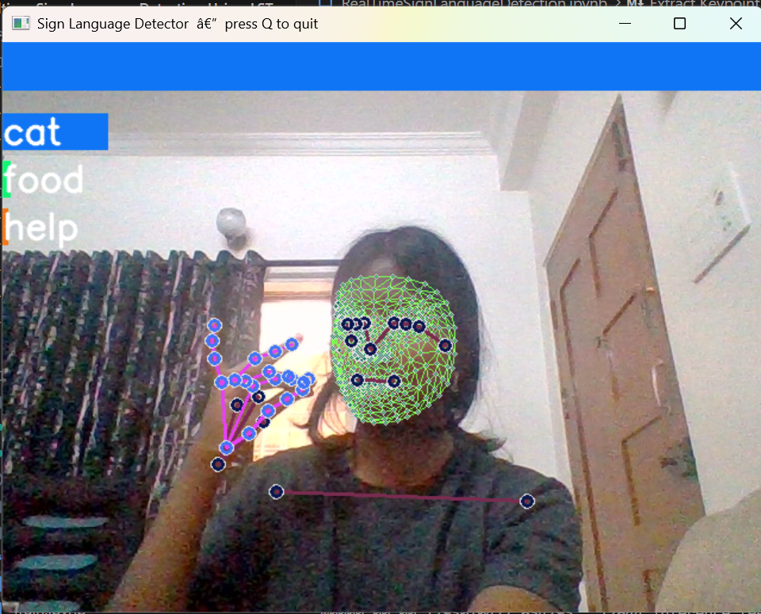
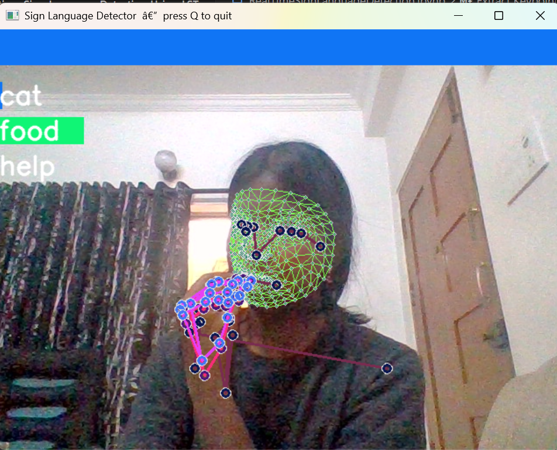
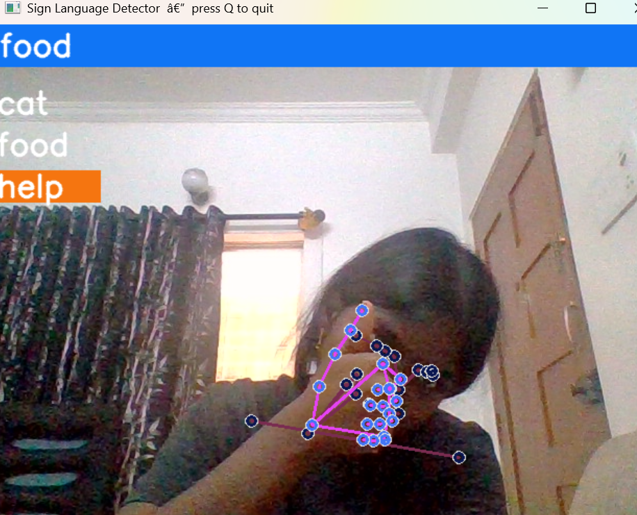
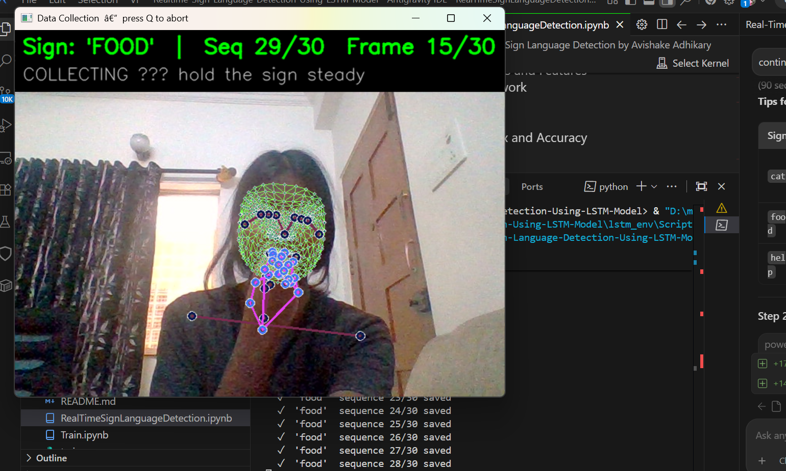

# Realtime Sign Language Detection Using LSTM Model



> A deep learning project that detects and interprets **Indian Sign Language** gestures in real-time using an LSTM neural network and MediaPipe Holistic landmark detection. Point a webcam at your hands and the system instantly recognises your signs.

---

## Table of Contents

- [Demo](#demo)
- [About the Project](#about-the-project)
- [Features](#features)
- [Signs Detected](#signs-detected)
- [Project Structure](#project-structure)
- [Getting Started](#getting-started)
- [Usage](#usage)
- [How It Works](#how-it-works)
- [License](#license)

---

## Demo

### Real-time Detection

| Cat Sign | Food Sign | Help Sign |
|----------|-----------|-----------|
|  |  |  |

### Data Collection



*Collecting training sequences for the "food" sign — 30 frames × 30 sequences per sign.*

---

## About the Project

This project uses a **Long Short-Term Memory (LSTM)** neural network to recognise sign language gestures from live webcam video.

Instead of processing raw pixels, it extracts **1662 pose/hand/face keypoints** per frame using **MediaPipe Holistic**, then feeds a sliding window of 30 consecutive frames into the LSTM — capturing the *motion* of the sign, not just a static snapshot.

The system can be retrained on any new signs in minutes using the included data-collection and training scripts.

---

## Features

- 🎥 **Real-time detection** — runs on a standard webcam at interactive frame rates
- 🧠 **LSTM architecture** — captures temporal motion patterns, not just static poses
- 🖐️ **MediaPipe Holistic** — tracks face (468 pts), pose (33 pts), and both hands (21 pts each) = 1662 keypoints/frame
- 🔧 **Fully retrain-able** — collect your own data with `collect_data.py`, retrain with `train.py`
- 📊 **Built-in evaluation** — confusion matrix + per-class F1 scores via `evaluate.py`
- ✋ **Stability filtering** — 70% majority vote over 20 frames prevents flickering
- 🔤 **Sentence building** — consecutively recognised signs are joined into a running sentence

---

## Signs Detected

The pre-trained model recognises three signs:

| Sign | Description |
|------|-------------|
| `cat` | Draw whiskers outward from nose with both index fingers |
| `food` | Tap grouped fingertips to lips repeatedly |
| `help` | Place closed fist on open palm and lift upward |

> You can add any number of new signs by editing `collect_data.py` and rerunning data collection + training.

---

## Project Structure

```
Realtime-Sign-Language-Detection-Using-LSTM-Model/
│
├── detect.py                         # ▶ Run real-time sign detection
├── collect_data.py                   # 📷 Collect your own training data
├── train.py                          # 🏋️ Train / retrain the LSTM model
├── evaluate.py                       # 📊 Confusion matrix & accuracy metrics
│
├── model.h5                          # Saved Keras model
├── model_weights.h5                  # Saved model weights
│
├── RealTimeSignLanguageDetection.ipynb  # Original notebook (reference)
│
├── screenshots/                      # Demo images for README
│   ├── cat_detection.png
│   ├── food_detection.png
│   ├── food_top.png
│   ├── help_detection.png
│   └── data_collection.png
│
└── README.md
```

---

## Getting Started

### Prerequisites

- Python **3.9** (required — TensorFlow 2.13 does not support Python 3.10+)
- A working webcam

### Installation

1. **Clone the repository**
   ```bash
   git clone https://github.com/Pranavipulluri/Sign-Language.git
   cd Sign-Language
   ```

2. **Create a Python 3.9 virtual environment**
   ```bash
   # Windows (PowerShell)
   & "C:\Users\<YourUser>\AppData\Local\Programs\Python\Python39\python.exe" -m venv lstm_env
   .\lstm_env\Scripts\Activate.ps1
   ```

3. **Install dependencies**
   ```bash
   pip install tensorflow==2.13.0 opencv-python mediapipe==0.10.14 \
               scikit-learn matplotlib numpy jupyter scipy
   ```

---

## Usage

### 1 — Collect your own training data
```bash
python collect_data.py
```
A window opens. For each sign you get a **2-second countdown** then **30 frames** are auto-captured. Repeats **30 times per sign**.

### 2 — Train the model
```bash
python train.py
```
Uses early stopping; typically converges in 5–15 minutes. Overwrites `model.h5` and `model_weights.h5`.

### 3 — Run real-time detection
```bash
python detect.py
```
Shows your webcam with landmark overlays, probability bars per sign, and a sentence banner at the top.  
**Press `q` to quit.**

### 4 — Evaluate the model
```bash
python evaluate.py
```
Prints accuracy / precision / recall / F1, displays a dual confusion matrix, and saves `evaluation.png`.

---

## How It Works

```
Webcam frame
    │
    ▼
MediaPipe Holistic
    │  extracts 1662 keypoints (pose + face + both hands)
    ▼
Sliding window  ──  last 30 frames  ──►  shape (30, 1662)
    │
    ▼
LSTM Model
    LSTM(64) → LSTM(128) → LSTM(64)
    Dense(64) → Dense(32) → Dense(3, softmax)
    │
    ▼
Stability vote (20-frame window, 70% majority)
    │
    ▼
Detected sign → sentence banner
```

---

## License

This project is released under the **MIT License** — free to use, modify, and distribute with attribution.
